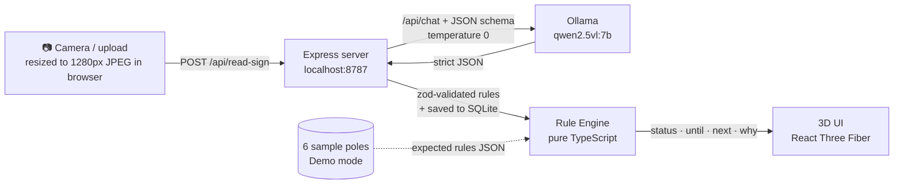

# ParkSense — “Can I park here?” in 3D, 100% on-device

Point your camera at a confusing stack of parking signs. A **local vision model** (Ollama, running on your own computer, $0, no cloud) transcribes the signs into strict JSON. A **pure, unit-tested TypeScript rule engine** decides. The answer appears as a huge **YES, until 4:00 PM** or **NO**, next to a living 3D street scene that rebuilds the sign pole panel by panel. Drag through the week to watch the sky turn to night, the street lamp switch on, the controlling sign light up and a little car park or drive away. The photo never leaves your machine, and every answer comes with a plain-English “Why?”.

> ParkSense is a helper, not legal advice. Always double-check the sign.

## What makes it different

|                               |                                                                                                                                 |
| ----------------------------- | ------------------------------------------------------------------------------------------------------------------------------- |
| 🔒 **On-device and free**     | Vision runs through Ollama on `localhost`. No API keys, no cloud, no telemetry. Fonts are self-hosted too.                      |
| 🧠 **AI reads, code decides** | The model only extracts text. A deterministic engine makes the yes/no call.                                                     |
| 🪧 **3D Sign Twin**           | The detected signs are rebuilt as 3D panels on a pole. The controlling panel glows and the ones that don't apply right now dim. |
| ⏪ **Time-travel scrubber**   | A slider plus a draggable 3D clock ring cover the next 7 days. The sky, lamp, panels, car and answer all update live.           |
| 🧱 **Week Tower**             | A 7 × 24 grid of 3D bars colored by status. Hover a bar to see the rule, click it to jump there.                                |
| ❓ **“Why?” trace**           | Step-by-step reasoning that quotes the sign line it used.                                                                       |
| ✋ **Human-in-the-loop**      | Every extracted rule is an editable chip. Low confidence (< 0.7) shows a yellow “Please confirm what I read” banner.            |
| ⏰ **Leave-by reminder**      | A countdown ring plus a browser notification 10 minutes before.                                                                 |
| 🔊 **Spoken answer**          | Read aloud with the browser's built-in `speechSynthesis`.                                                                       |
| 🧪 **Demo mode**              | 6 built-in sample poles with known rules, so it works with no Ollama (e.g. on Vercel).                                          |

## Architecture



```
client/   React 18 + Vite + TS, Tailwind, Framer Motion, three.js via @react-three/fiber/drei/postprocessing, Zustand
  src/engine/      ← the rule engine (no React, no `any`, 27 Vitest cases)
  src/scene/       ← 3D: street, sign pole twin, car, clock ring, Week Tower (all procedural)
  src/samples/     ← 6 sample sign stacks, rendered to SVG in code + expected rules
server/   Express + TS (tsx), better-sqlite3 history, zod validation, Ollama client
scripts/  export-samples.ts → writes the sample SVG + JSON files to client/public/samples
```

## Setup

1. **Install Ollama** from https://ollama.com and start it (`ollama serve`, or just open the app).
2. **Pull a vision model:**
   ```bash
   ollama pull qwen2.5vl:7b
   ```
3. **Install and run:**
   ```bash
   npm install
   npm run dev
   ```
4. Open **http://localhost:5173**.

Other scripts: `npm test` (all tests), `npm run build`, `npm run lint`, `npm run format`, `npm run samples` (re-export the sample SVGs), `npm start` (serve the built API).

**Environment variables (server):** `OLLAMA_URL` (default `http://localhost:11434`), `OLLAMA_MODEL` (force a model), `API_PORT` (default `8787`), `OLLAMA_TIMEOUT_MS` (default `180000`), `DB_PATH` (default `server/data/parksense.db`).

### Model selection

On startup the server calls `GET /api/tags` and picks the first installed model from this list: `qwen2.5vl:7b` → `gemma3:4b` → `llama3.2-vision`. You can see the choice at `GET /api/health`. If Ollama isn't reachable, or no vision model is installed, the UI switches to Demo mode on its own and shows the exact command to run.

### Hardware note

`qwen2.5vl:7b` needs about **8 GB of RAM** (more is better; Apple Silicon or a GPU makes it much faster). On lighter machines use **`gemma3:4b`** (`ollama pull gemma3:4b`). The server picks it up automatically.

### Using it on your phone

`getUserMedia` needs HTTPS or `localhost`. To test on a phone on the same Wi-Fi, run the client with `npm run dev -w client -- --host` and use a tunnel or HTTPS proxy, or just upload a photo instead of using the live camera.

## Live demo

**https://saigupta954.github.io/parksense/**: Demo mode with the 6 sample poles. It's deployed by `.github/workflows/pages.yml`, which runs the tests and lint first, on every push to `main`. To read your own photos, run it locally with Ollama.

## Deploy the client for free (Demo mode)

The client is a static site. With no server behind it, `/api/health` fails and the app runs in Demo mode with the 6 sample poles.

- **GitHub Pages:** already set up via `.github/workflows/pages.yml` (it builds with `VITE_BASE=/<repo>/`).
- **Vercel:** import the repo, set **Root Directory = `client`**. The included `client/vercel.json` handles build and SPA rewrites.
- **Netlify:** set **Base directory = `client`**. The included `client/netlify.toml` handles the rest.

(Optional: set `VITE_API_BASE` at build time to point the client at a ParkSense server you run yourself.)

## API

| Method   | Path               | Notes                                                                                                                                                              |
| -------- | ------------------ | ------------------------------------------------------------------------------------------------------------------------------------------------------------------ |
| `GET`    | `/api/health`      | `{ ollama: { reachable, model, installed }, pullCommand }`                                                                                                         |
| `POST`   | `/api/read-sign`   | `{ imageBase64, thumbnailBase64? }`. Over 8 MB → `413`. Invalid model JSON → retried once with a stricter reminder, then `422`. Timeout → `504`. No model → `503`. |
| `GET`    | `/api/history`     | Recent scans (rules JSON, timestamp, model, thumbnail)                                                                                                             |
| `DELETE` | `/api/history/:id` | Delete a scan                                                                                                                                                      |

Request logs contain only method, path, status and duration. Image data is never logged (there's a test for this).

## Why AI reads but code decides

Vision models are great at **reading** text in messy photos. They are unreliable at **reasoning** about days and times: “Is 11:05 on a Tuesday inside 10AM–12PM TUE?”, overnight windows that cross midnight, “except Sunday”, which of four stacked signs wins. A model can get those wrong confidently and differently every time.

So ParkSense splits the job:

1. **The model transcribes.** It is forced into a strict JSON schema (`format` = JSON schema, `temperature: 0`) and told never to guess unreadable text. Instead it lowers its `confidence` and explains in `notes`.
2. **Code double-checks the model.** In testing, qwen2.5vl:7b transcribed the sign text correctly but sometimes filled in the structured fields wrong: it added Mon–Fri to a sign that prints no days, read "6PM – 8AM" as ending at 20:00, and missed a "Zone B" exemption. `server/src/reconcile.ts` re-derives days, times, sign type and permit zone from the transcribed `rawText`, overrides the model where they disagree, explains each correction in `notes`, and drops confidence below 0.7 so the UI asks you to confirm.
3. **zod validates** the output and normalizes small slips (`"4PM"` → `"16:00"`, `"Tuesday"` → `"TUE"`, `88` → `0.88`).
4. **You can check it.** Every field is an editable chip, and low confidence triggers a confirm banner.
5. **A pure function decides:** `evaluate(rules, at, profile)`. Same input, same output, every time. It is unit-tested and explains itself step by step.

That makes every answer **explainable** (the “Why?” trace quotes the sign), **testable** (27 engine tests), **instant to re-run** (edit a chip and the answer updates in under a millisecond) and **time-travelable**: the 3D scrubber and the Week Tower re-run the engine thousands of times without calling the AI again.

### Engine rules

- **Priority, most restrictive wins:** tow-away / no stopping > no parking > street cleaning > loading zone (unless commercial) > permit only (unless your permit matches) > metered > time limit > allowed. If no sign applies, the answer is **allowed**, with a note that unsigned rules may still apply.
- Overnight ranges (`22:00–06:00`) belong to the day they start and spill past midnight.
- `anytime`; missing days = every day; “EXCEPT SUNDAY” / “EXCEPT SAT–SUN”.
- Arrows: signs pointing away from the side you chose are skipped.
- `allowedUntil` steps forward minute by minute (up to 7 days) until the status gets worse, capped by the time limit only if the limit is still in force then. `nextAllowedAt` steps forward until parking is allowed.
- `weekGrid()` returns the 7 × 24 matrix behind the Week Tower.

## Design decisions

- **3D-first, few words:** the scene takes about two-thirds of the screen. The panel shows a big YES/NO, one short line, and compact rows. The reasoning, sign editor and reminder open on tap, and details live in tooltips. On phones the scene sits on top with a bottom sheet; on tablets the scene gets 55% of the height.
- **City street at night:** asphalt `#0B0D10`, sodium-lamp `#FFB347` glow, signage red `#E0322B` and permit green `#1FA463` used only as accents, plus CSS film grain. Overpass (open-source, inspired by US highway signage) for signs and headings, Inter for body text.
- **Fonts are self-hosted** via `@fontsource` instead of loaded from the Google Fonts CDN, so nothing leaves the device.
- **Status is never color-only:** always an icon plus words (✓ Allowed, ⏱ 2-hour limit, $ Paid, 🅿 Permit only, ✕ No parking).
- **All 3D is procedural:** three.js primitives plus canvas textures (asphalt, concrete, lit windows). Sign panels are drawn from the _same_ vector description used to render the sample “photos”, so the twin matches the photo.
- **No troika/drei `<Text>`:** it fetches fonts from a CDN. 3D labels use `<Html>` overlays and `CanvasTexture`.
- **Performance:** the 3D canvas is lazy-loaded (separate ~250 KB gz chunk). Initial JS is about 106 KB gz (budget: 600 KB). DPR is capped at 2 with `AdaptiveDpr`. The engine pre-compiles rules so a 7-day look-ahead stays fast while you drag.
- **Reduced motion:** with `prefers-reduced-motion`, the car doesn't drive (it just appears or disappears), the camera snaps instead of gliding, panels don't fly in, and film grain and the scan line stop.
- **Accessibility:** a native `<input type="range">` scrubber (arrow keys, Home/End) with a spoken `aria-valuetext`, an `aria-live` region that announces the answer (debounced while you drag), focus-trapped dialogs, and visible focus rings.
- **Time-limit semantics:** if a 2-hour limit ends at 6 PM and you arrive at 5 PM, you aren't told to leave at 7 PM. The cap applies only if the limit is still in force when it runs out.
- **One time range per sign entry:** the schema has a single `start`/`end`, so a sign that says “7–9AM & 4–7PM” is extracted as two entries (the prompt says so). The 3D twin and sample renderer merge identical consecutive panels.
- **The server binds to 127.0.0.1 only** and uses `API_PORT`, not `PORT`, so it never collides with the Vite dev server or other tools.
- **Reminders** use `setTimeout` + the Notification API (no server push). They fire only while the tab is open. If notifications are blocked, the reminder is spoken and shown on screen instead.
- **zod v4** is used, because v3 has a published memory-exhaustion advisory.

## Tests

- `client/src/engine/engine.test.ts`: 27 engine cases (overnight ranges, Sunday exception, stacked conflicting signs, matching vs non-matching permit, time-limit cap, arrow filtering, end-of-week wrap, anytime tow-away, week grid, determinism…)
- `client/src/components/components.test.tsx`: React Testing Library (answer, editable chips re-running the engine, confirm banner, keyboard scrubber)
- `server/src/reconcile.test.ts`: re-checks the model's fields against its own transcription, using the real mistakes qwen2.5vl:7b made on the samples (invented weekdays, 6PM–8AM read as 18:00–20:00, missed Zone B exemption, wrong sign type)
- `server/src/app.test.ts`: model selection, schema normalization, retry-then-422, 413/400/503/504, history CRUD, no image data in logs
